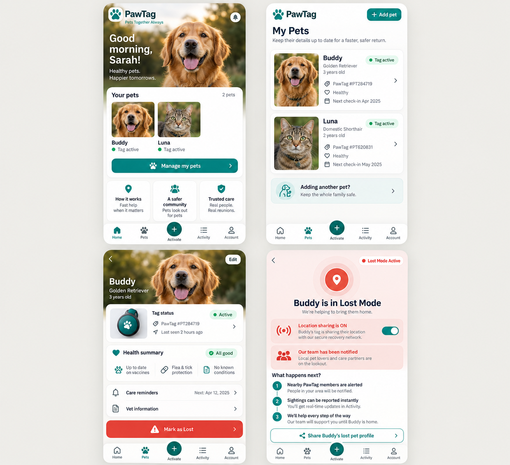
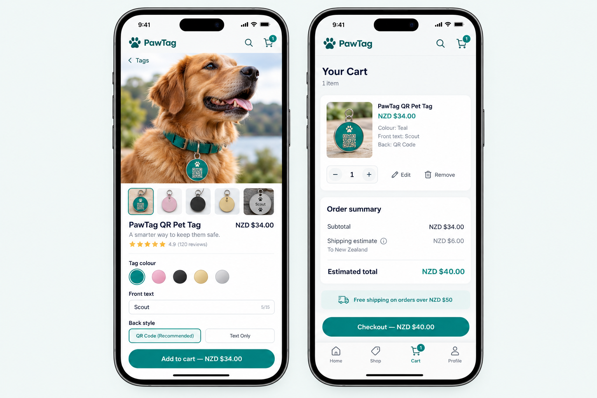
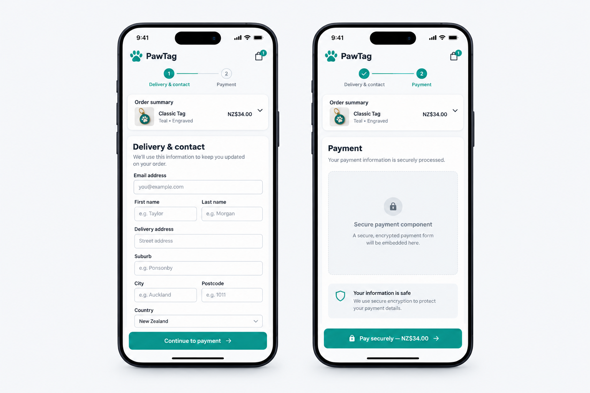
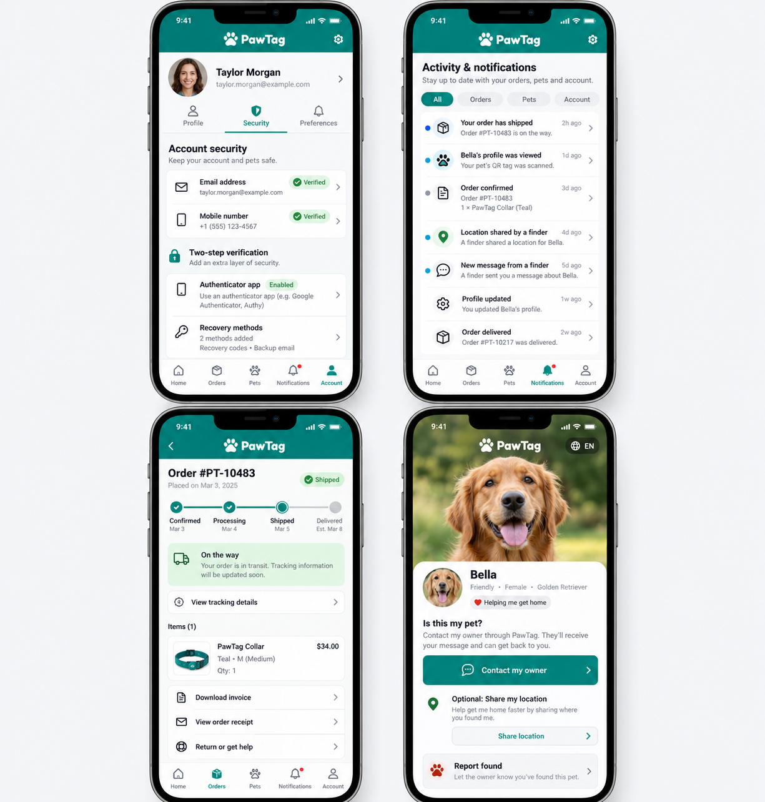

# PawTag Mobile Customer & Finder Experience

## UX audit, design direction, and UI implementation specification

**Repository snapshot reviewed:** `PawTag-main (1).zip`, uploaded 23 October 2026  
**Review scope:** customer and Finder mobile experience, shared-web presentation, and screen-level UX  
**Work performed:** source/document review and design concepts only  
**No application source, business rules, or configuration were changed.**

---

## 1. Executive summary

PawTag’s current repository contains two different mobile directions:

1. `apps/mobile` is a separate Expo / React Native customer application with its own screens and navigation.
2. The active execution pack under `docs/execution/2026-10-06/` has selected a web-first customer experience: `apps/web` is the one customer UI, a thin Capacitor shell will package it, and the current Expo screens will be kept as migration reference until parity is proven.

The second direction matches the product requirement: customer pages and journeys are maintained once in the web application, and the installed app consumes that shared UI. The current Expo app does **not** yet behave that way. Its route tree does not contain several important web journeys, including shopping, Cart, Checkout, account profile, and customer notifications.

The mobile UX work should therefore focus on making the shared customer web routes excellent at phone widths and preparing them to run in an app shell. It should not create a parallel set of React Native customer screens. The public Finder experience remains a separate, browser-first surface so a stranger can scan a tag without installing PawTag or signing in.

One expectation needs to be precise: the active plan packages the built web assets inside the native app and explicitly avoids a generic remote-site WebView. With that model, a **new UI route or React code change still needs a native app build/release** to reach installed users. Server-managed data and CMS content can update without an app release. A thin shared UI reduces duplicated work and keeps browser and app releases aligned; it does not make arbitrary web-code changes appear in an already-installed bundled app automatically.

### Priority findings

| Priority | Finding | Evidence in this snapshot | Direction |
|---|---|---|---|
| P0 | The current Expo app is still a separate customer UI. | `apps/mobile/src/navigation/RootNavigator.tsx` imports native screen components and defines a native stack/tab tree. | Follow the active Phase 08–10 web-first migration path; do not add more native product screens. |
| P1 | Current native navigation omits web customer journeys. | The native tree has Home, Pets, Activate and several detail screens; no Shop, Cart, Checkout, Profile, Notifications or Invoices route is registered. | Make the web routes responsive and available through the shared customer UI. |
| P1 | Existing native home is a launchpad of actions rather than a customer overview. | `apps/mobile/src/screens/HomeScreen.tsx` presents a vertical quick-action list and a Sign Out action on Home. | Use one responsive customer dashboard with pet status, important activity and clear next actions. |
| P1 | New web UI does not currently flow into the existing Expo UI. | `apps/web/src/App.tsx` and `apps/mobile/src/navigation/RootNavigator.tsx` maintain separate route/component trees. | The active Capacitor plan is the intended way to share the web UI. |
| P1 | Cart and Checkout have responsive foundations in the web source, but no real-device proof is included in this review. | `Cart.tsx` and `Checkout.tsx` contain 8/4 desktop columns, mobile single-column behavior and sticky mobile action bars. | Preserve the desktop 70/30 layout; validate and refine the existing mobile composition at phone widths. |
| P1 | Finder is already a separate browser app, which is appropriate for the finder’s situation. | `apps/finder/src/App.tsx` routes `/` and `/:tagId`; README says no account is required and prioritizes mobile-first recovery. | Keep Finder public and browser-first; do not route public tag URLs into the owner app. |
| P2 | Push notification tap navigation is not complete in the current native navigator. | `RootNavigator.tsx` subscribes to notification responses, but the `petId` branch contains a comment that navigation is handled elsewhere; no navigation action is shown there. | In the future shell, map notification destinations to shared web routes and validate foreground/background/terminated states. |
| P2 | The existing mobile UX audit is historical context, not proof of current readiness. | `docs/mobile-ux-audit.md` is dated 6 August 2026 and references the previous native-screen plan. | Reconcile it against current Phase 08–10 direction and actual execution evidence. |

---

## 2. Scope and constraints

### Included

- Mobile customer experience using the existing shared web application.
- Public Finder mobile-browser journey.
- Mobile visual hierarchy, navigation, touch interaction, layout, states, accessibility, and usability.
- Cart and Checkout presentation on phone and tablet widths.
- Native capability entry points only where useful to the shared UI: camera/QR, NFC, push, deep links, secure session storage, lifecycle and back behavior.
- A phased UI implementation specification for a future authorized coding task.

### Excluded from this review and current work

- Admin, CSR, and website-admin mobile experience.
- Environment, signing, deployment, or other configuration changes.
- API, database, authentication policy, payment, tax, pricing, subscription, Finder privacy, notification-delivery, or other business-rule changes.
- Application code changes.
- Claims that a build, automated test, emulator, simulator, or physical device was executed.

The future UI work should call existing routes and contracts. If an existing workflow cannot be rendered without changing business behavior, document the dependency for a separate decision; do not silently change that behavior as part of visual work.

---

## 3. Evidence and source-of-truth notes

The review used the attached repository snapshot and inspected the root `AGENTS.md`, `README.md`, `docs/DESIGN.md`, the current execution pack’s `00_READ_ME_FIRST.md`, Phases 08–10, the web route table, the mobile navigator and representative mobile screens.

The current execution pack states these product decisions:

- `apps/web` is the customer UI source for browser and future installed iOS/Android app.
- `apps/finder` remains a browser-only public recovery experience.
- `apps/admin` remains desktop-first.
- Existing Expo screens are migration reference; no new duplicate customer screens should be built.
- The future installed app uses a thin Capacitor shell after the shared web UI is mobile-ready.
- The existing Expo UI is retired only after feature parity and physical-device validation.

The repository README still describes `apps/mobile` as a React Native app with native-rendered screens and discourages rendering DOM/Tailwind UI inside React Native. The current execution pack is newer and explicitly sets the web-first migration path. For this document, the current execution pack is treated as the intended product direction; the README and older August mobile audit should be reconciled during the documentation phase of that migration.

This was a source-based review. It did not run the application or capture actual PawTag screens. The image boards below are generated design concepts, not screenshots and not pixel-perfect specifications. Their invented sample names, dates, prices, counts, and labels are illustrative only. The written requirements and actual repository business rules take precedence.

---

## 4. Current route and screen inventory

| Customer/Finder area | Shared web source | Current Expo/mobile source | Mobile UX assessment |
|---|---|---|---|
| Public home and shop | `/`, `/shop`, `/shop/:id` | No equivalent Shop/Product routes in `RootNavigator.tsx` | Major parity gap. Build the mobile experience from the shared web pages. |
| Registration and login | `/login`, `/register`, `/verify-account`, `/verify-email`, `/forgot-password`, `/reset-password` | Login, Register, ForgotPassword screens | Separate implementations create drift risk. The web flow must remain the UI source. |
| Customer dashboard | `/account` | `HomeScreen` | Native Home is a long quick-action list, not the same dashboard journey. |
| Pets | `/account/pets`, account health-record UI | PetList, PetDetail, AddPet, HealthRecords screens | Existing native functionality can inform requirements, but the new shared UI must cover the complete flow. |
| Tag activation | `/account/redeem-tag`, `/account/tag-activation-fee` | QRScanner, NFCScanner, RedeemTag | Native capabilities should hand a scanned value to the existing shared activation journey. |
| Lost/recovered status | Customer account routes and shared pet views | LostMode and PetDetail screens | Use the same web journey and present the current state prominently on mobile. |
| Cart and Checkout | `/cart`, `/checkout` | No Cart or Checkout route in native navigator | Major customer commerce gap in current Expo app. Existing web layout already has responsive/mobile patterns to validate. |
| Orders, order details, returns, invoices | `/account/orders`, `/account/orders/:id`, `/account/orders/:id/return`, `/account/invoices`, `/account/invoices/:id` | OrderHistory only | Web includes deeper journeys. Mobile must support order detail, tracking, return status and invoice access through shared routes. |
| Membership and rewards | `/account/subscriptions`, `/account/guardian`, `/account/guardian/points`, `/account/guardian/rewards`, `/account/upgrade`, `/account/membership...` | Subscription and Guardian screens | Preserve complete web route coverage and make mobile navigation discoverable. |
| Notifications and preferences | `/account/notifications`, `/account/notification-preferences` | No notification center or preferences screen in navigator | Significant parity gap; notification taps should open the corresponding shared route. |
| Profile, security, settings, support | `/account/profile`, `/account/settings`, `/contact`, `/faq` | No profile/settings/support screen in navigator | Significant parity gap; add to shared mobile navigation/account area. |
| Public Finder | `apps/finder`: `/`, `/:tagId` | No Finder screen in owner app | Correctly remains a public browser journey. Do not require app install or customer login. |

The native navigator currently presents three tabs (Home, Pets, Activate). The current Phase 08 document recommends a five-destination installed-app navigation model—Home, Pets, Activate, Activity, Account—while retaining the same shared React Router pages. Treat the five destinations as app-mode navigation/chrome over shared routes, not five new native screen implementations.

---

## 5. Design system direction

`docs/DESIGN.md` is the active visual authority. Extend its current system rather than creating a new mobile brand.

### Preserve

- Primary teal palette, especially `primary-600` (`#0d9488`) for primary actions and active states.
- Gray neutral scale and semantic red, green, amber, blue, purple and gold status colours.
- System sans-serif typography; the defined body and heading scale.
- Four-pixel spacing rhythm.
- `rounded-xl` controls and `rounded-2xl` cards.
- PawTag’s intended character: warm and reassuring, modern and professional, approachable and plain-spoken.
- Calm, supportive language for lost-pet flows. Avoid alarmist decoration or toy-like styling.

### Mobile-specific presentation rules

- Single-column flow for narrow screens; do not squeeze desktop two-column layouts into mobile.
- Preserve readable content width and spacing at 320–430 CSS pixels.
- Design around touch, one-handed use, safe areas, software keyboards and screen-reader order.
- Use sticky actions only when they remain clear of the home indicator, keyboard, bottom navigation and content.
- Maintain visible focus and disabled states, text labels alongside meaningful status icons, and loading/empty/error/success states.
- Respect reduced-motion and text scaling. Do not rely on hover.
- Use the same semantic components/tokens across web browser and app-mode rendering.

### Avoid

- New arbitrary colours, shadows, radii, gradients, fonts or icon styles.
- Emoji as primary navigation or action icons in the final premium experience.
- Dense tables, multi-column forms or tiny tap targets on phones.
- Repeating large trust/benefit panels across every screen.
- Decorative animation during stressful Finder or payment moments.

---

## 6. Screen-by-screen mobile experience specification

These are presentation requirements. They do not change account, payment, Finder, notification or other business rules.

### 6.1 Public home and product discovery

- Keep the main value proposition concise and pet-owner focused.
- Present one clear primary action, then product discovery and reassurance.
- Use product imagery with stable aspect ratios and avoid a desktop mega-menu on phones.
- Keep public browsing and customer-account navigation distinct.
- Ensure a new web page uses the shared route and appears in browser/app-mode route navigation once the corresponding web build is released.

### 6.2 Registration, verification and login

- Use a calm, uncluttered form with correctly typed mobile keyboards and autofill hints.
- Show email and mobile verification as two distinct progress items using existing verification state.
- Do not change the current requirement that both channels must be confirmed before customer activation.
- Provide clear resend/edit/retry states using existing endpoints and cooldowns.
- Preserve return context, such as returning to Checkout after registration, using existing behavior.
- MFA, if returned by the current authentication flow, should be a clear continuation of login with a visible expiry/resend state. Do not add or change MFA methods in this UI task.

### 6.3 Customer dashboard

- Replace the current conceptual “launchpad” layout with a prioritized overview: pet safety/status first, next action second, recent activity third.
- Surface an active lost-pet state immediately and make recovery status understandable.
- Keep secondary destinations in navigation rather than showing every action as an equal large card.
- Include meaningful empty state for a new customer with a guided “Add a pet” or “Activate a tag” action.

### 6.4 Pets list, add/edit and pet detail

- Use photo-led pet cards with name, tag status and the most useful short health/status information.
- Make Add Pet a persistent, obvious action without competing with the pet cards.
- On detail, group identity, tag status, care/health summary and actions into short cards.
- Reserve destructive actions for a secondary menu and use the existing confirmation behavior.
- Show last-known/update timestamps only where existing data supports them; never imply live location when it is not available.

### 6.5 Lost Mode

- Make the current state unmistakable and explain what the existing action has done.
- Keep owner-visible recovery information, sightings/activity and support actions in a clear sequence.
- Use restrained red/amber status styling. Do not use flashing effects or frightening copy.
- Provide clear recovery/mark-found affordance consistent with the existing workflow.

### 6.6 Tag activation, QR and NFC

- Keep a single activation journey in the shared web UI.
- Native camera or NFC capability returns a normalized scan result to that shared journey; it must not implement activation rules itself.
- Always offer manual entry when scanning is unavailable or permission is denied.
- Explain what permission is needed at the moment it is needed.
- Present invalid, duplicate, unsupported, cancelled and success states as recoverable outcomes.

### 6.7 Shop, Cart and Checkout

- Reuse `/shop`, product detail, `/cart` and `/checkout` from `apps/web`.
- Preserve the desktop 8/4 (approximately 70/30) Cart/Checkout composition at desktop widths.
- At phone widths, use a single column, compact/collapsible summary and a safe-area-aware bottom action where useful.
- Keep product photo, customisation, quantity, remove/edit, inventory/price state, subtotal, discounts/rewards, shipping estimate, GST statement and total easy to scan.
- Keep the order summary available across Checkout steps without duplicating the form or changing the payment path.
- The visible payment fields remain owned by the current payment provider component. The generated concept board is not a specification for provider UI.
- Do not show a total as final if the existing server quote marks it estimated or shipping is unknown.
- Handle keyboard-open, validation, payment authentication, failure, retry, pending finalisation and return from external authentication without hiding the next action.

### 6.8 Orders, returns and invoices

- Present status and next expected action at the top of each order.
- Use a compact vertical progress display rather than a desktop table.
- Keep tracking, item summary, invoice and eligible return action easy to find.
- Keep invoice access in the existing secure route and do not alter access policy.

### 6.9 Membership, rewards and subscriptions

- Put current membership state and practical benefits before promotional content.
- Keep balance, points history, rewards and subscription status distinct and scannable.
- Reuse the existing route hierarchy and display semantics. Do not change entitlements or payment behavior.

### 6.10 Activity, notifications, profile and settings

- Provide one Activity/Notifications destination with unread state and clear event timestamps.
- A notification tap should open the relevant shared customer route; do not embed sensitive details in notification preview copy.
- Keep Profile, Security, Notification Preferences and Settings grouped under Account.
- Display existing email/mobile verification state as status; this plan does not change factor setup or account policy.

### 6.11 Finder public journey

- Keep the flow in `apps/finder` and in the system browser, even when PawTag owner app is installed.
- Show privacy-approved pet details, a clear contact/report action, and optional location sharing only as allowed by the current product behavior.
- Do not force account creation or app installation.
- Make location denied, invalid tag, safe pet, deactivated tag, rate limit, network error and report-accepted states clear.
- Do not claim the owner was notified unless the existing system confirms delivery; preserve current API response semantics.

---

## 7. Illustrative high-fidelity concept boards

The boards apply the PawTag teal/gray system and show the intended mobile composition. They are concepts only; the actual route, copy, data, state and API behavior must come from the repository.

### Customer home, pets and lost mode

### Product discovery and Cart

### Checkout delivery and payment

### Account, activity, orders and public Finder

The account concept includes an illustrative authenticator/recovery section. It is not evidence that PawTag currently supports those factors and is not an instruction to add or change MFA policy in this UI-only scope.

---

## 8. UI-only implementation sequence for a future coding task

This sequence is for a later authorized implementation. It does not authorize code edits in this review. Keep each phase scoped to user-interface presentation, route availability and visual/accessibility tests. Reuse the current business logic and API contracts.

### Phase A — Mobile route and component inventory

- Map every public/customer route in `apps/web/src/App.tsx` to an existing responsive page and customer navigation entry.
- Map each route to the current Expo feature only as a migration reference.
- Identify missing UI states and direct links from notifications, email, QR/NFC and Checkout return paths.
- Acceptance: complete route matrix with no unexplained customer/Finder destination gaps.

### Phase B — Shared responsive shell and navigation

- Refine the shared customer layout for narrow browser and installed-app mode.
- Use the current Phase 08 navigation model: Home, Pets, Activate, Activity, Account.
- Ensure all destinations resolve to shared web routes.
- Ensure public Finder URLs remain outside the owner navigation/app interception behavior.
- Acceptance: navigation works by direct URL, browser back, app back and account state; no duplicate React Native navigation tree is added.

### Phase C — Core customer screens

- Prioritize dashboard, Pets, pet detail, add/edit, Lost Mode, tag activation, profile/settings and notifications.
- Reuse existing web components and design tokens; add only responsive presentation variants where needed.
- Add loading, empty, error and success views for each route.
- Acceptance: full task completion at 320–430px and tablet portrait, with keyboard and safe-area checks.

### Phase D — Commerce and account depth

- Validate/refine Shop, product detail, Cart, each Checkout step, Orders, order detail, Invoices, Returns, Membership and Rewards.
- Preserve the existing authoritative checkout/payment flow and desktop 70/30 layout.
- Use shared web routes in app mode; do not build a native checkout copy.
- Acceptance: mobile flows retain entered context, expose errors, and do not hide payment/order state.

### Phase E — Finder and platform-capability presentation

- Refine the public Finder route for scan-to-report speed and non-account use.
- Bind QR/NFC, location, push taps and deep links to shared route entry points through the existing platform boundary planned in Phase 08/09.
- Acceptance: browser fallback works when native capability is denied, absent or unavailable.

### Phase F — Accessibility and visual consistency

- Check touch targets, text scaling, labels, focus order, contrast, reduced motion, sticky elements, modals and screen readers.
- Compare desktop and mobile states against `docs/DESIGN.md`.
- Acceptance: no critical accessibility or overflow defect on tested customer/Finder journeys.

### Phase G — UI validation evidence

- Add or update responsive browser tests for route entry, forms, navigation and sticky actions.
- Add visual checks for representative phone/tablet widths.
- Use native shell and physical-device tests only when the separate shell phase is in scope; this task does not claim these have run.
- Acceptance: each implemented UI phase has test output and visual evidence; device-only checks remain clearly marked unverified until executed.

---

## 9. Design and usability test matrix

| Area | Viewports/states | Required checks |
|---|---|---|
| General customer shell | 320, 360, 375, 390, 430 px; tablet; desktop | No horizontal scroll, no clipped controls, clear nav state, direct-route load and browser back. |
| Authentication | Registration, verification pending, one channel verified, both complete, MFA challenge, validation error | Keyboard types, field focus, resend/retry affordance, status hierarchy, no keyboard overlap. Existing verification policy is unchanged. |
| Pets | Empty, one pet, multiple pets, long names, missing image, active/lost tag | Card scanability, actions remain reachable, status is not colour-only. |
| Tag activation | Camera granted/denied, NFC unsupported/cancelled, manual entry, invalid/duplicate/success | Clear permission rationale, fallback, no duplicate submit. |
| Lost Mode | Active, inactive, reconnecting, no recent activity | Calm urgent styling, status clarity, action confirmation and accessibility. |
| Cart | Empty, one/multiple items, customisation, inventory/price notice, estimated shipping | Sticky bottom bar does not obscure last row; summary is understandable; quantity and remove actions are touch-friendly. |
| Checkout | Delivery, payment, keyboard open, SCA/external return, decline, pending, success | One-column flow, summary access, errors visible, focus moves appropriately, no hidden provider controls. |
| Orders/invoices | Processing, shipped, delivered, returned/refunded as supported | Timeline readable, invoice entry visible, long reference numbers wrap safely. |
| Notifications | Empty, unread, many events, tap destination | Unread state accessible; tapping opens correct shared route. |
| Finder | Lost/safe/invalid/deactivated tag; location denied; slow/offline; report submitted | Fast browser entry, privacy-safe details, no login demand, truthful confirmation. |

No rows in this matrix were executed during this review.

---

## 10. Future implementation acceptance criteria

The customer/Finder mobile UI work is ready for review when:

- `apps/web` remains the only customer product UI source.
- No new React Native customer or Finder product screens are created.
- All current customer web routes are usable in narrow layouts and can be reached through app-mode navigation.
- Public Finder routes remain browser-first and do not require installation or login.
- Desktop Cart/Checkout retain the intended 8/4 (approximately 70/30) structure; mobile uses a deliberate single column.
- Existing business behavior, API contracts and policies remain unchanged by the UI task.
- The UI uses `docs/DESIGN.md` tokens and brand character.
- Critical loading, empty, error, success, offline and permission-denied states are present where applicable.
- Touch, keyboard, safe-area, accessibility and reduced-motion checks are complete.
- Responsive browser tests pass, and physical-device evidence is recorded separately when a native shell is part of the authorized phase.
- The release/update behavior is described honestly: bundled React/UI code changes require a native app release unless a separately reviewed, policy-compliant update mechanism is adopted.

---

## 11. Handoff instructions for OpenCode

Use this document as the **mobile UX specification**, alongside the current execution pack’s `phases/08_SHARED_WEB_MOBILE_APP_FOUNDATION.md`, `phases/09_CAPACITOR_SHELL_NATIVE_BRIDGES.md` and `phases/10_IOS_ANDROID_STORE_AND_DEVICE_GATE.md` for architecture and device-release work.

Before implementation:

1. Read the current root `AGENTS.md` and `README.md`.
2. Read `docs/DESIGN.md` and the current execution-pack phase being implemented.
3. Inspect the current source and verify that route names and components still match this snapshot.
4. Work on UI presentation only within the explicitly authorized phase.
5. Keep business rules, API contracts, database behavior, payment behavior, account verification policy and configuration unchanged.
6. Add tests for observed user behavior, not tests that simply mirror markup.
7. Report which routes were actually run and which device/browser checks remain outstanding.

If the requirement “a new web page appears in the installed app without an app update” is mandatory, stop before choosing the delivery mechanism and present the tradeoff: the active plan’s local asset bundle requires a release for JavaScript/UI changes, while a remote-loaded or live-updated web bundle changes the security, availability, rollback and app-store review profile. Do not silently switch architecture during a visual implementation phase.

---

## 12. Files reviewed

- `AGENTS.md`
- `README.md`
- `docs/DESIGN.md`
- `docs/mobile-ux-audit.md` (historical audit)
- `docs/execution/2026-10-06/00_READ_ME_FIRST.md`
- `docs/execution/2026-10-06/phases/08_SHARED_WEB_MOBILE_APP_FOUNDATION.md`
- `docs/execution/2026-10-06/phases/09_CAPACITOR_SHELL_NATIVE_BRIDGES.md`
- `docs/execution/2026-10-06/phases/10_IOS_ANDROID_STORE_AND_DEVICE_GATE.md`
- `docs/execution/2026-10-06/reference-plans/PawTag_Web_First_iOS_Android_App_Plan.md`
- `apps/web/src/App.tsx`
- `apps/web/src/pages/Cart.tsx`
- `apps/web/src/pages/Checkout.tsx`
- `apps/mobile/src/navigation/RootNavigator.tsx`
- `apps/mobile/src/screens/HomeScreen.tsx`
- `apps/mobile/src/screens/LoginScreen.tsx`
- `apps/mobile/src/screens/RegisterScreen.tsx`
- `apps/finder/src/App.tsx`
- `apps/mobile/e2e/qr-activation.yaml`
- `apps/mobile/e2e/nfc-activation.yaml`
- `apps/mobile/e2e/lost-mode.yaml`

